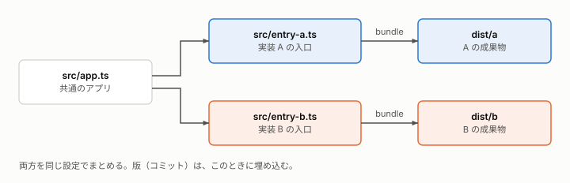

# 構成と仕様

**この文書の読み手:** <このリポジトリのコードと構成を、調べに来た人>。「何が、どう作られているか」の事実の一覧。

関連する文書:
- 設計の理由: [design-decisions.md](design-decisions.md)
- 動かし方: [runbook.md](runbook.md)
- 設計と進め方: [plan.md](plan.md)
- 確かめた事実: [findings.md](findings.md)
- 用語: [用語集](glossary.md)

## 要旨
- **構成:** <部品とその関係を 1 行で>
- **入口:** <利用者が最初に触るもの>
- **この文書に書かないこと:** 設計の理由（design-decisions）、手順（runbook）、日付と実績（log）。

## 1. 全体像
<部品と、データや要求の流れを 1 段落で。次の図で見せる。>

## 2. 部品の一覧
| 部品 | 役割 | 場所 |
|---|---|---|
| <名前> | <1 行で> | <パス> |

## 3. 成果物のビルド
<入力から成果物ができるまで。次の図は、段と矢印の使い方の例。>

## 4. インターフェース
### 4-1. <入口の名前>
- **入力:** <形式>
- **出力:** <形式>
- **エラー:** <種類と意味>

## 5. 設定と制約
<既定値、上限、環境の前提。値は 1 か所にだけ書き、ほかからはリンクする。>
