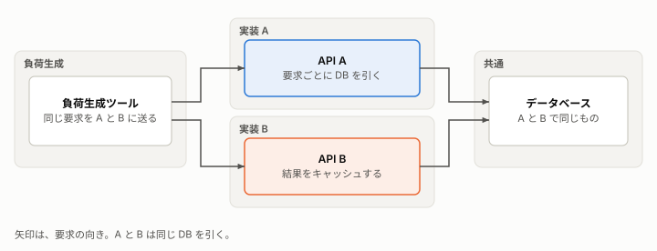

# <採る方式と、その理由（設計書）>

**この文書の読み手:** <実装する人と、設計をレビューする人>。これから作る、または変えるものの設計を書く。設計の答えが 1 つに決まらないときに書く。実装の手順書にはしない。今ある構成の事実は [構成](architecture.md)、判断の一覧は [設計判断](design-decisions.md)、要件は [要件定義](requirements.md)。用語は [用語集](glossary.md)。分量の目安は、小さな変更で 1〜3 ページ、大きな設計で 10〜20 ページ。

## 要旨
- **解くこと:** <要件のどれを満たすか（ID で書く）>
- **採る方式:** <方式を 1〜2 行で>
- **主な判断:** <最も重い判断と、その理由を 1 行で>（[代替案とトレードオフ](#6-代替案とトレードオフ)）
- **リスク:** <最も大きいものを 1 行で>

## 1. 背景と範囲
<周辺の状況と、何を作るかを、短く事実で書く。要件の再掲にはしない。>

## 2. 目標と非目標
**目標:** <この設計が達成すること>
- <目標。要件の ID を添える>

**非目標:** <目標になりえたが、意図して外したこと。「〜しない」と言い換えただけの目標は書かない>
- <非目標と、外した理由>

## 3. 方式の概要
<全体の考え方を 1 段落で。第一文に方式を書く。次の図で部品の関係を見せる。>

## 4. 構成要素
| 要素 | 役割 | 満たす要件 |
|---|---|---|
| <名前> | <1 行で> | <R-1 など> |

## 5. インターフェースとデータ
### 5-1. <入口の名前>
- **入力:** <形式>
- **出力:** <形式>
- **エラー:** <種類と扱い>

### 5-2. <データの名前>
<項目、型、保存先、寿命。>

## 6. 代替案とトレードオフ
この節は、設計書で最も重い。退けた案を、トレードオフで説明する。何もしない案も置く。

| 論点 | 採る案 | 退けた案 | 退けた理由 | 採る案の欠点 |
|---|---|---|---|---|
| <決めること> | <案> | <案。何もしない案を含む> | <トレードオフを 1 行で> | <採ることで失うもの> |

## 7. 横断的な関心事
<セキュリティ、プライバシー、可観測性、運用、費用への影響を、各 1〜2 文で。影響がないものは「影響なし」と書く。>

## 8. リスクと対策
| リスク | 影響 | 対策 |
|---|---|---|
| <起こりうること> | <起きたときの影響> | <事前の対策、検知、戻し方> |

## 9. 移行と展開
<既存のものからの切り替え手順、段階、戻す条件。新規なら「なし」と書く。>

## 10. 未決事項
未決事項は、解決する時期で分ける。
- **この設計の承認までに:** <決めること>
- **実装の間に:** <決めること>
- **この設計の範囲外:** <関連する課題>
