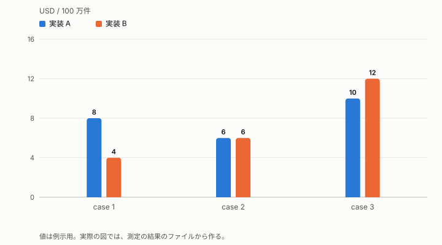

# <結論を 1 文で。主張になる見出しにする>

<何を、いつ、どの条件で調べたか>（1 行）

**この文書の読み手:** <読み手を、前提知識と一緒に 1 行で>。用語は [用語集](glossary.md) にある。

## 要旨
- **調べたこと:** <対象と条件を 1 行で>
- **答え 1:** <結論を、数字 1 つ以内で>
- **答え 2:** <結論>
- **信頼できる範囲:** <測れなかったこと、当てはまらない条件>（[4-2](#4-2-信頼できる範囲)）。使い分けの目安は [2-3](#2-3-使い分けの目安)。

## 1. <なぜ調べたか。仮説を主張の形で>
<背景と、確かめたかったことを 1〜2 段落で。第一文に要点を置く。>

## 2. 結論
### 2-1. <結論 1 を主張の形で>
<第一文に結論。続けて根拠を 1〜2 文。数字は 1 段落に 3 個まで。傾向や差は、表ではなく図にする。>

### 2-2. <結論 2 を主張の形で>
<同じ型。>

### 2-3. 使い分けの目安
| 条件 | 選ぶもの | 理由 |
|---|---|---|
| <条件> | <選択肢> | <理由を 1 行で> |

## 3. なぜそうなるか
### 3-1. <仕組みを主張の形で>
<結論の理由。構成の事実は [構成](architecture.md)、確かめた事実は [事実集](findings.md) にリンクし、ここには繰り返さない。>

## 4. 予測と結果、信頼できる範囲
### 4-1. 事前の予測と結果
| 予測 | 結果 | 一致 |
|---|---|---|
| <測る前に書いた予測> | <結果を 1 行で> | <はい / いいえ / 測れなかった> |

### 4-2. 信頼できる範囲
- **測れたこと:** <条件と範囲>
- **測れなかったこと:** <理由。結論は出さない>
- **推定:** <推定は「推定」と書き、根拠を添える>
- **前提:** <結論が成り立つ前提>。外れたときの影響: <どの結論が変わるか>

## A. 詳細
### A-1. <ケースまたは項目>
<細かい数字、ばらつき、個別の結果。本文に置かなかったものはここに置く。>

## B. 条件と採用
<環境、版、採用と除外の基準。結果を見てから基準を変えない。>

## C. 根拠
<コマンド、出典の URL、取得日。再現に要るもの。>

## D. 未確認と次の候補
<分かっていないことと、次にやること。日付や実績は、[経過](log.md) に書く。>
