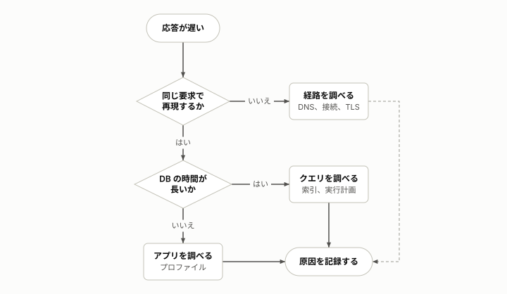

# 運用の手順

**この文書の読み手:** <このリポジトリを動かす人。確認、実行、後片付けまで>。構成の事実は [architecture.md](architecture.md)、設計は [plan.md](plan.md)、用語は [用語集](glossary.md)。

**実行前の約束**
- <費用や影響が出る操作は、見積もりを出して承認を得る>
- <戻しにくい操作は、先に対象を見せる>

## 前提
- <必要なツールとバージョン>
- <必要な権限や認証。値そのものは書かない>

## ローカルでの確認
```sh
<確認のコマンド。例: テストと型の検査>
```
期待する結果: <何が出れば成功か>。

## <実行の手順 1>
1. <コマンドまたは操作>
2. <次の操作>

期待する結果: <成功の見分け方>。失敗したときは [つまずきやすい点](#つまずきやすい点) を見る。

## 結果の置き場所
<出力のファイルの構成と、再現のしかた>

## 後片付け
<消すもの、残るもの。消す前に対象を確かめる方法>

## 切り分けの流れ
<原因を絞る手順が分岐するときは、フローチャートで見せる。判断の枝には「はい」「いいえ」を書く。>



## つまずきやすい点
- **<症状>:** <原因と対処を 1〜2 行で>
