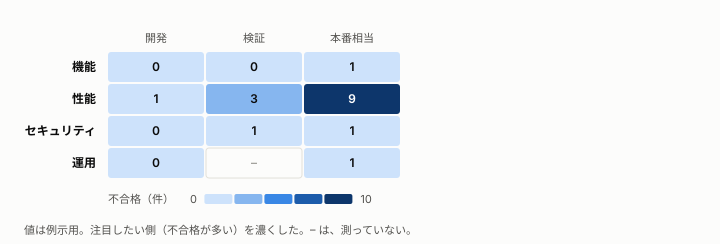

# <対象>のテスト結果: <合否の結論を 1 文で>

**この文書の読み手:** <リリースや次の工程を判断する人>。テストの結果と、残るリスクを伝える。完了の基準は [テストケース](test-cases.md) に、要件は [要件定義](requirements.md) にある。用語は [用語集](glossary.md)。

## 要旨
- **結論:** <合格 / 条件つきで合格 / 不合格、と理由を 1 行で>
- **実施:** <実施したケースの数と、合格・不合格の数>
- **完了の基準:** <基準を満たしたか、満たさなかった点は何か>
- **残るリスク:** <リリース判断に効くものを 1 行で>

## 1. 不合格と対処
| ID | 症状 | 影響 | 対処 |
|---|---|---|---|
| <ケース ID> | <何が起きたか> | <利用者への影響> | <修正、回避、許容の別と、その理由> |

## 2. 計画との差
<計画と違ったこと。実施しなかったケースと理由、追加したケースと理由。結論に与える影響を書く。なければ「なし」。>

## 3. 完了の基準に照らした判断
<観点の網羅と、完了の基準に照らして、結論の理由を書く。網羅できなかった観点と、その理由も書く。事実と推定を分ける。>

<観点と環境の網羅は、ヒートマップで見せる。注目したい側（不合格が多い）を濃くする。>

## 4. 阻害要因と、得た教訓
- **阻害要因:** <テストの進行を妨げたこと>
- **教訓:** <次に活かすこと。再利用できるテストの資産>

## A. 全件の結果
| ID | 結果 | 備考 |
|---|---|---|
| <ケース ID> | <合格 / 不合格 / 未実施> | <補足> |

## B. 実施の条件
- **実施日:** <日付>
- **対象の版:** <コミットまたは版>
- **環境:** <環境と構成>
- **実施者:** <担当>
