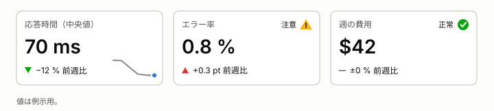
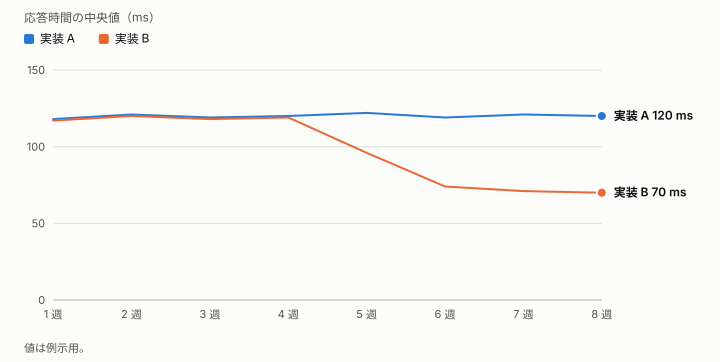
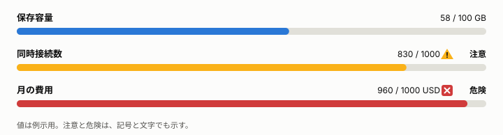

# <期間>の週報

**この文書の読み手:** <報告先の人。状況を 1 分で知りたい人>。進み具合と、助けが要ることを先に書く。用語は [用語集](glossary.md)。

## 要旨
- **進んだこと:** <最も大きい進捗を 1 行で>
- **遅れていること:** <遅れと、取り戻す見込み。なければ「なし」>
- **助けが要ること:** <誰に、何を頼みたいか。なければ「なし」>
- **決めてほしいこと:** <判断を求めること。期限つき。なければ「なし」>

<数字が主張のときは、グラフにせず、タイルで見せる。状態は、記号と文字を併記する。>

## 進捗
| 項目 | 状況 | 次にやること |
|---|---|---|
| <項目> | <完了 / 進行中 / 遅れ> | <次の 1 手> |

## 課題とお願い
- **<課題>:** <影響と、頼みたいこと。期限があれば書く>

## 来週の予定
- <予定を 1 行で。担当と期限を添える>

次の報告日: <日付>
